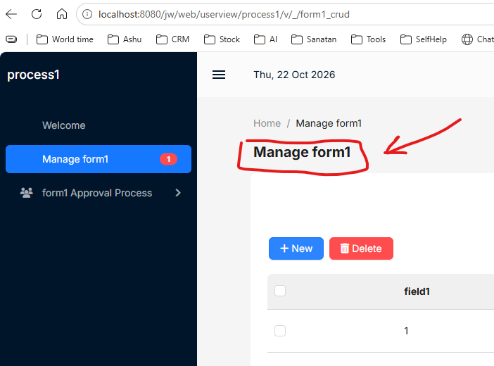

# Hide Default Joget Page Heading

**Search tags:** Joget, DX9, CSS, page heading, form title, hide heading, `h4.page-heading`, Userview

- **Purpose:** Hide Joget's generated page heading while keeping internal Form Section titles.
- **Where to use:** **Joget DX9 → Userview Theme → Custom CSS**.
- **Applicability:** Any page using the given theme with a matching `h4.page-heading` element.
- **Test status:** Applied in the user's GRC theme; not independently retested here.

## Before screenshot — default heading visible



*Before applying the CSS:* The heading **Manage form1** is displayed above the Data List. The red annotation points to the heading that `h4.page-heading { display: none !important; }` hides. The breadcrumb **Home / Manage form1** is a separate element and is not hidden by this rule.

## Code

```css
/* GRC - Hide default Joget page heading */
h4.page-heading {
    display: none !important;
}
```

**[Download the CSS snippet](../code/css/hide-joget-page-heading.css)**

## How to apply

1. Open your GRC **Userview Builder** and its **Theme** configuration.
2. Paste the CSS into **Custom CSS**, then save/publish the Userview as needed.
3. Reload a page that contains a Joget page heading.
4. Confirm the default heading disappears and the labels inside Form Sections remain visible.

## How to undo

Remove the rule from Custom CSS and reload the page.

## Notes

- This is a **global** selector within the theme. Scope to a specific page if you only want one page affected.
- Do **not** confuse `h4.page-heading` with `.form-section-title`.
